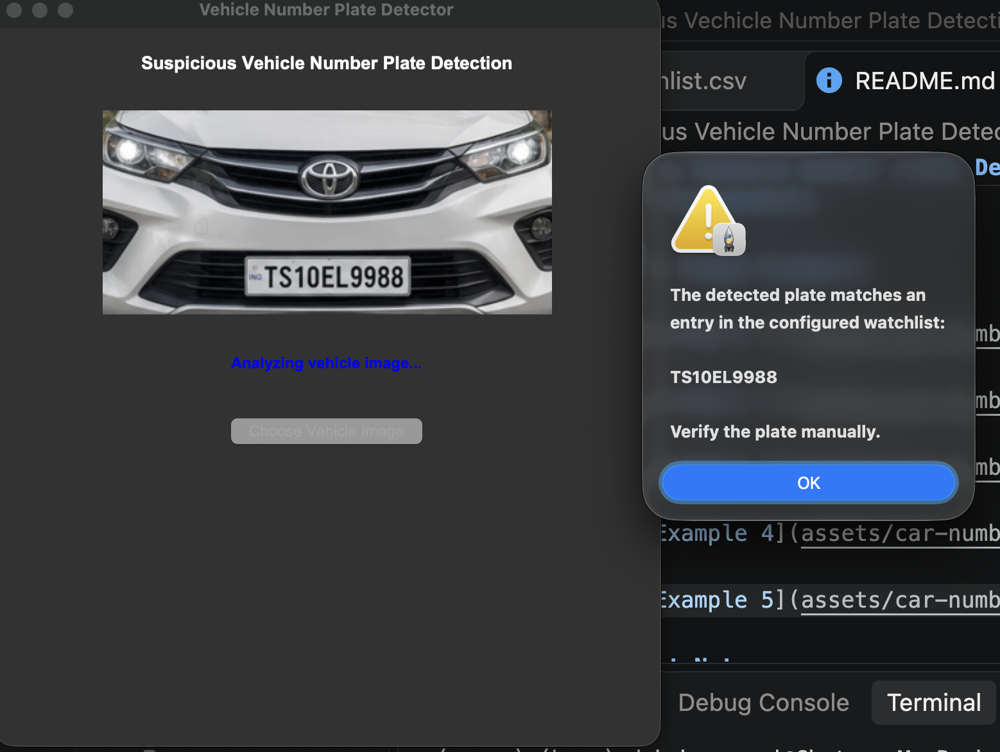
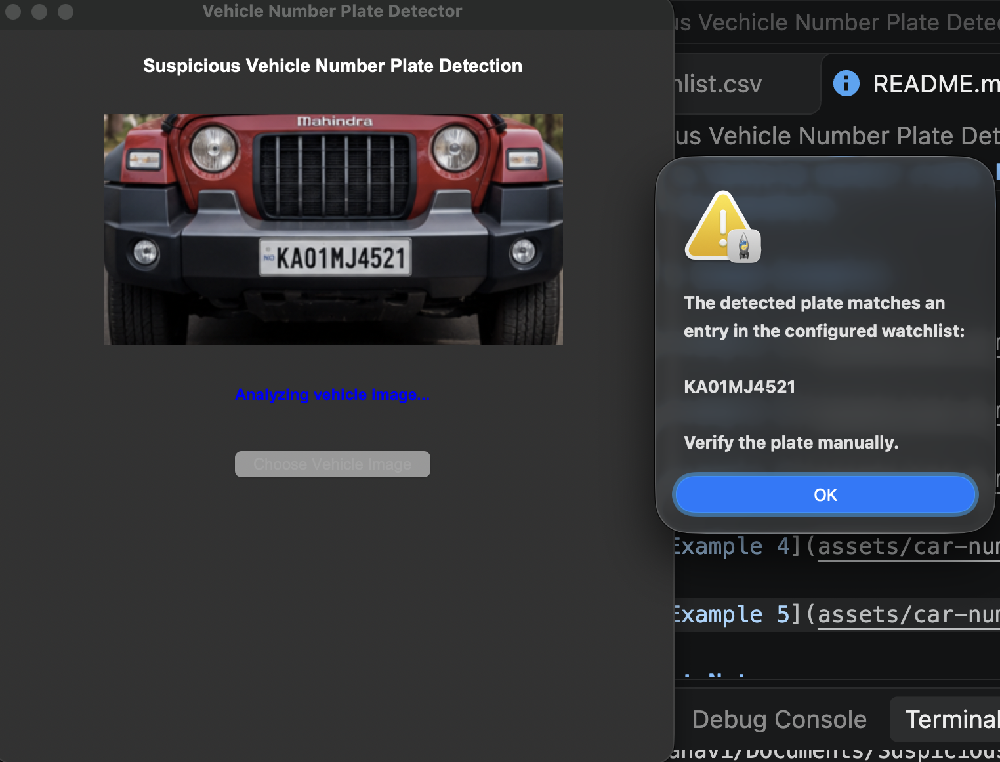
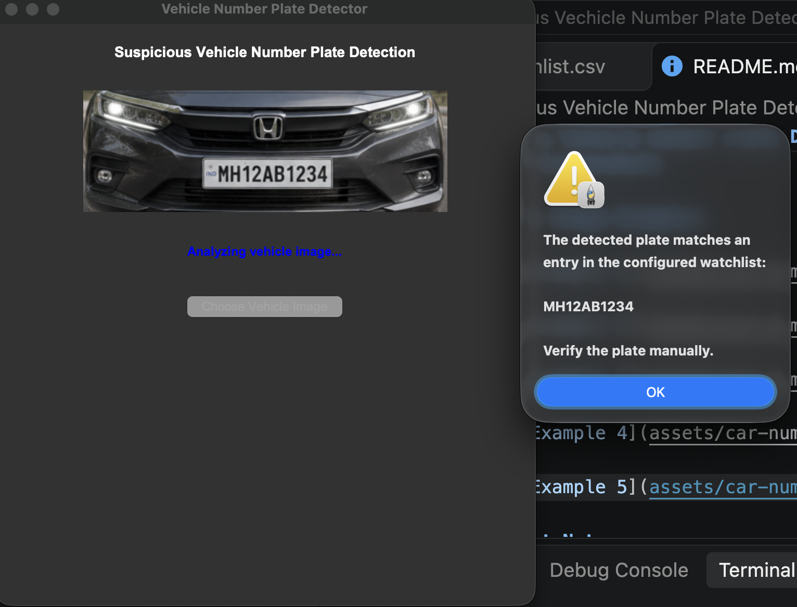
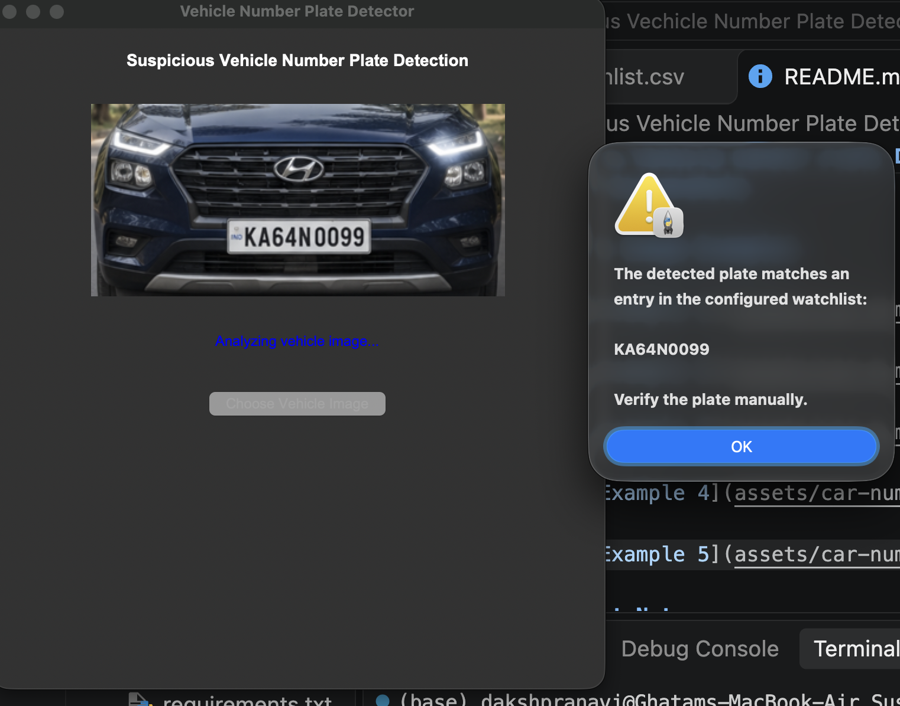

# Suspicious Vehicle Number Plate Detection Using Generative AI

A Python-based desktop application that uses Google's Gemini API to extract Indian vehicle registration numbers from uploaded vehicle images and compare them against a configurable CSV-based watchlist.

## Features

- Upload vehicle images using a Tkinter desktop interface.
- Extract registration numbers using Google's Gemini multimodal API.
- Normalize registration numbers by removing spaces and punctuation.
- Compare extracted numbers against a CSV watchlist.
- Display warning notifications when a watchlist match is found.
- Handle unreadable number plates and temporary API errors.

## Technologies Used

- Python
- Google Gemini API (`google-genai`)
- Tkinter
- Pillow
- CSV
- python-dotenv

## Project Structure

```text
Suspicious-Vehicle-Number-Plate-Detection/
│
├── assets/
│   ├── car-number-plate-1.webp
│   ├── car-number-plate-2.png
│   ├── car-number-plate-3.png
│   ├── car-number-plate-4.png
│   └── car-number-plate-5.png
│
├── plate_detector.py
├── vehicle_watchlist.csv
├── requirements.txt
├── .env.example
├── .gitignore
└── README.md
```

## Installation

1. Clone the repository:

```bash
git clone https://github.com/dakshraj-coder/Suspicious-Vehicle-Number-Plate-Detection.git
cd Suspicious-Vehicle-Number-Plate-Detection
```

2. Create and activate a virtual environment:

```bash
python -m venv .venv
```

3. Install dependencies:

```bash
pip install -r requirements.txt
```

4. Create a `.env` file and configure your Gemini API key:

```env
GEMINI_API_KEY=your_api_key_here
```

Get an API key from [Google AI Studio](https://aistudio.google.com/apikey).

5. Run the application:

```bash
python plate_detector.py
```

## Watchlist Format

The application reads vehicle registration numbers from `vehicle_watchlist.csv`.

Example:

```csv
vehicle_number,status
KA64N0099,Flagged
TS10EL9988,Flagged
KA01MJ4521,Flagged
21BH2345AA,Flagged
MH12AB1234,Flagged
```

The application compares normalized registration numbers. The current implementation uses the `vehicle_number` column for matching.

## How It Works

1. The user selects a vehicle image.
2. The application displays the selected image.
3. Gemini analyzes the image and returns the visible registration number.
4. Python normalizes the extracted number.
5. The application loads the CSV watchlist.
6. The extracted number is compared with the watchlist.
7. A warning appears if a match is found; otherwise, the application displays no match.

## Project Screenshots

### Vehicle Image Examples

## Application Output Screenshots

The following screenshots demonstrate the application's Gemini-based number plate extraction and CSV watchlist matching results.

### 1. Watchlist Match – TS10EL9988



### 2. Watchlist Match – KA01MJ4521



### 3. Watchlist Match – MH12AB1234



### 4. Watchlist Match – KA64N0099



*Note: These are demonstration results using test images and a configured CSV watchlist. A match does not establish suspicious activity and requires manual verification.*

## Important Notes

- A watchlist match only indicates that the extracted registration number exists in the configured CSV file.
- A match does not establish suspicious or criminal activity. Results must be manually verified.
- Gemini API access requires an internet connection and a valid API key.
- Never upload your actual `.env` file or expose your API key.
- Use fictional or authorized test registration data in public demonstrations.

## Future Improvements

- Integrate OpenCV for dedicated number plate localization and image preprocessing.
- Add OCR-based recognition for comparison.
- Improve recognition accuracy under different lighting and image conditions.
- Add a database-backed watchlist.
- Develop a more detailed vehicle management dashboard.

## Author

**Bala Sriram Dakshraj Ghatam**

GitHub: [dakshraj-coder](https://github.com/dakshraj-coder)

